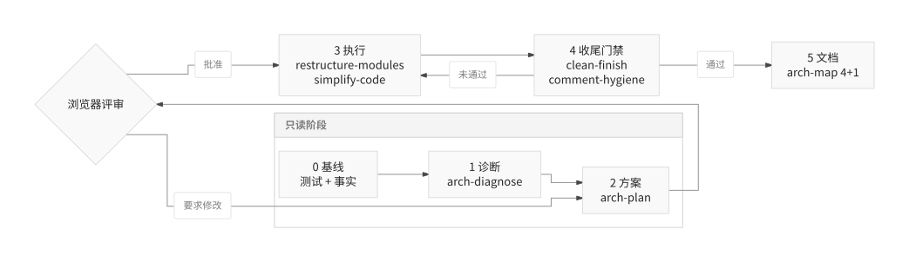

# opencode-clean-arch

让 Agent 写出来的 Python 代码回到**一份实现、职责清晰、没有遗留版本、有图可看**的状态。

这是一个 opencode 插件，包含 8 个 skill、5 个斜杠命令和 4 个工具，同时支持 opencode 1.x 与 2.x：

- **先诊断、再评审、后动手**：诊断和方案阶段只读，方案在浏览器里逐句批注，批准后才改代码；
- **不留中间版本**：合并/移动时同步更新所有调用方，删除旧实现，不加别名、转发、兼容开关；
- **收尾门禁**：脚本扫描平行版本、重复代码、兼容层、断裂导入、注释掉的代码、调试输出、叙述式注释；
- **短而准的架构文档**：4+1 视图 + 数据视图 + 设计决策，Mermaid 源码 + 渲染好的 SVG（CodeHub 等不渲染 Mermaid 的平台也能看）。



## 包含什么

| Skill | 作用 |
|---|---|
| `clean-arch` | 总流程：基线 → 诊断 → 方案评审 → 执行 → 收尾门禁 → 文档 |
| `arch-diagnose` | 只读诊断：平行版本、重复、循环依赖、依赖方向、上帝类、透传层，按影响排序并附证据 |
| `arch-plan` | 写方案（前后对比图、删除清单、可验证步骤），提交浏览器评审，按批注修改直至批准 |
| `restructure-modules` | 模块/包/类的移动、重命名、合并副本、拆分、破循环；同一步更新所有引用 |
| `simplify-code` | 函数与类级别的等价简化（守卫语句、参数对象、dataclass、删除投机抽象和防御性噪音） |
| `comment-hygiene` | 注释只写“为什么”和约束；删除改动叙述、历史、复述代码、注释掉的代码 |
| `clean-finish` | 完成门禁：遗留扫描、删除清单核对、结构检查、测试、diff 卫生 |
| `arch-map` | 生成 4+1 架构文档（≤80 行/页、≤20 节点/图）+ 面向 AI 的模块索引、术语表、分层规则 |

| 命令 | 说明 |
|---|---|
| `/clean-arch [范围]` | 完整流程，范围可以是子目录或包名，留空为整个仓库 |
| `/arch-diagnose [范围]` | 只做诊断，输出 `.clean-arch/diagnosis.md` |
| `/arch-map [范围]` | 只生成/更新架构文档，不改代码 |
| `/clean-finish [基准提交]` | 对当前改动跑收尾门禁 |
| `/arch-review [文件]` | 在浏览器评审任意 Markdown（默认 `.clean-arch/plan.md`） |

| 工具 | 说明 |
|---|---|
| `clean_arch_facts` | 静态分析（只解析不导入代码）：包依赖、循环、未解析导入、重复（含改了变量名的复制）、热点、核心类排名、subprocess/脚本调用、Mermaid 草图、分层规则检查；`importers` 列出某模块的全部引用（导入、测试、脚本、配置、文档）；`verify` 核对图里的模块/类/依赖箭头是否与代码一致 |
| `clean_arch_leftovers` | 遗留扫描，支持 `since=<git ref>` 只看本次改动 |
| `clean_arch_render` | `*.mmd` → 自包含 SVG（颜色写死、无外部字体），适合代码托管平台直接预览；对渲染器不支持的写法和过宽的图给出警告 |
| `clean_arch_review` | 打开评审页面并阻塞等待结论，返回结构化批注 |

## 安装

前置条件：opencode ≥ 1.16 或 2.x；Python ≥ 3.10（分层规则检查需要 3.11+ 的 `tomllib`）。分析脚本只用标准库。

插件只用到 1.x 插件包里的 `tool` 辅助函数，该接口在 1.16 与 1.19 之间没有变化。skill 通过配置项 `skills.paths` 注册；如果你的 opencode 较老、装好后看不到 skill，把 `skills/` 下的目录复制到项目的 `.opencode/skills/` 即可（见下文“只用 skill，不装插件”）。

### opencode 1.x

```bash
# 安装到当前项目（写入 .opencode/opencode.json），加 -g 安装到全局
opencode plugin "git+https://github.com/Gipbear/opencode-clean-arch.git"
```

或手动写配置：

```json
{ "plugin": ["git+https://github.com/Gipbear/opencode-clean-arch.git"] }
```

### opencode 2.x

```bash
opencode plugin add "git+https://github.com/Gipbear/opencode-clean-arch.git"
```

或手动写配置（注意 2.x 的键名是 `plugins`）：

```json
{ "plugins": ["git+https://github.com/Gipbear/opencode-clean-arch.git"] }
```

固定到某个发布版本时，在地址后加标签，例如 `…/opencode-clean-arch.git#v0.1.0`，版本列表见 [Releases](https://github.com/Gipbear/opencode-clean-arch/releases)。两种写法也都支持 `github:Gipbear/opencode-clean-arch`、`git+ssh://…` 和本地路径（`/path/to/opencode-clean-arch`）。

### 只用 skill，不装插件

把 `skills/` 下的目录复制到项目的 `.opencode/skills/`（或 `.claude/skills/`、`.agents/skills/`）。没有工具时，skill 会改为直接调用 `skills/clean-arch/scripts/*.py`；评审改为在对话里确认。

## 使用

```text
/clean-arch pkg/agent
```

Agent 会：

1. 跑测试建立基线，生成静态事实与遗留扫描结果（`.clean-arch/baseline.md`）；
2. 写诊断（`.clean-arch/diagnosis.md`），只给你 5–10 行摘要；
3. 写方案（`.clean-arch/plan.md`）并打开评审页面；
4. 你在页面里选中文字 → **评论 / 删除 / 替换**，填写总体意见 → **批准 / 批准并附意见 / 要求修改**；要求修改后 Agent 修改方案，再次打开页面，并显示与上一版的差异和上一轮意见；
5. 批准后逐步执行，每一步都跑验证；
6. 收尾门禁全部通过后，生成/更新 `docs/architecture/`。

只想要文档：`/arch-map`；只想检查一次 Agent 改完的代码有没有留尾巴：`/clean-finish main`。

### 评审页面

- 默认监听 `127.0.0.1` 的随机端口，链接带一次性 token，Agent 会在工具进度里显示链接，并尝试自动打开浏览器；
- 历史保存在 `.clean-arch/reviews/<文档名>/rN.md`（当次文本）和 `rN.json`（当次意见），下一轮自动对比；
- 页面草稿保存在浏览器本地存储，误刷新不会丢批注。

远程开发机（SSH / 云桌面）上使用：

```bash
# 开发机上固定端口
export CLEAN_ARCH_REVIEW_PORT=47123 CLEAN_ARCH_REVIEW_NO_OPEN=1
# 本地电脑转发后打开 Agent 给出的链接
ssh -L 47123:127.0.0.1:47123 <开发机>
```

| 环境变量 | 默认值 | 说明 |
|---|---|---|
| `CLEAN_ARCH_REVIEW_HOST` | `127.0.0.1` | 监听地址；设为 `0.0.0.0` 可在局域网访问（链接仍需 token） |
| `CLEAN_ARCH_REVIEW_PORT` | 随机 | 固定端口，便于端口转发 |
| `CLEAN_ARCH_REVIEW_PUBLIC_HOST` | — | 链接中显示的主机名（例如开发机域名） |
| `CLEAN_ARCH_REVIEW_TIMEOUT_MIN` | `120` | 等待评审的分钟数，超时后 Agent 改为在对话中确认 |
| `CLEAN_ARCH_REVIEW_NO_OPEN` | — | 设为 `1` 不自动打开浏览器 |
| `CLEAN_ARCH_PYTHON` | `python3` | 运行分析脚本的 Python |

## 产出物

```text
docs/architecture/            给人看：每页 ≤ ~80 行，表格优先
  README.md                   概览 + 系统上下文图 + 视图导航
  logical.md                  逻辑视图：核心类图（≤15 个类）
  development.md              开发视图：模块依赖、分层规则、新代码放哪里
  process.md                  进程视图：运行时进程/服务与通信
  physical.md                 物理视图：部署、资源、配置
  scenarios.md                场景视图：2–4 个关键时序图
  data.md                     数据视图（ML/数据项目）：数据集、模型、产物流向
  decisions.md                设计决策（ADR 精简版）
  diagrams/*.mmd + *.svg      Mermaid 源码与渲染结果
.clean-arch/                  给 AI 看，人无需关心
  modules.md                  模块索引：职责、依赖、新代码放哪
  glossary.md                 术语 ↔ 代码名
  rules.toml                  分层/禁止依赖/规模预算，clean_arch_facts check 校验
  baseline.md diagnosis.md plan.md finish-report.md
  plans/ reviews/             已批准方案与评审历史
  cache/                      临时文件（已加入 .gitignore）
```

**关于 CodeHub 预览**：CodeHub（CodeArts Repo）目前没有文档化的 Mermaid 渲染（社区仍在提需求），HTML 文件在仓库页面里通常只显示源码而不会作为网页预览，因此文档里用 `` 嵌入 SVG 图片，同时保留 `.mmd` 源码便于修改。SVG 由插件本地渲染，颜色已写死、不引用外部字体，在 CodeHub、GitHub、GitLab、Gitee 和 IDE 预览里显示一致。

## 兼容策略

- 仓库内部的代码移动、改名、合并：**同一次改动里更新所有调用方并删除旧实现**，不留别名、转发函数、`try/except ImportError` 回退、废弃告警和 `_v2`/`_old` 副本；
- 只有方案里列为“外部契约”并经你确认的接口才保持兼容：已发布的包 API、外部脚本依赖的 CLI 参数、磁盘上的文件格式（checkpoint、`state_dict` 键名、pickle 类路径）、网络接口、数据库结构。

## 命令行

不经过 opencode 也可以使用（需要 [bun](https://bun.sh)）：

```bash
bun src/cli.ts render docs/architecture/diagrams     # 重新渲染 SVG，可放进 CI
bun src/cli.ts review .clean-arch/plan.md            # 打开评审页面，结论打印到终端
python3 skills/clean-arch/scripts/arch_facts.py --root <repo> summary
python3 skills/clean-arch/scripts/arch_facts.py --root <repo> summary --brief     # 只输出指标表
python3 skills/clean-arch/scripts/arch_facts.py --root <repo> importers pkg.sub.mod  # 删除/移动前查全部引用
python3 skills/clean-arch/scripts/arch_facts.py --root <repo> verify docs/architecture  # 图与代码是否一致
python3 skills/clean-arch/scripts/leftover_scan.py --root <repo> --since main --fail-on high   # 默认退出码恒为 0，--fail-on 用于 CI
```

## 开发

```bash
npm install
npm test            # bun test（插件、渲染、评审服务）+ Python unittest（分析脚本）
npm run typecheck
```

代码结构：`src/index.ts` 同时导出 2.x 的 `setup()` 与 1.x 的 `server()`；`src/tools.ts` 定义与版本无关的工具，分别转换成 JSON Schema（2.x）和 zod（1.x）；`src/review/` 是评审页面；`skills/` 是 skill 正文与 Python 脚本。
