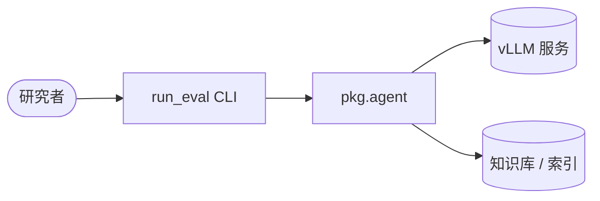
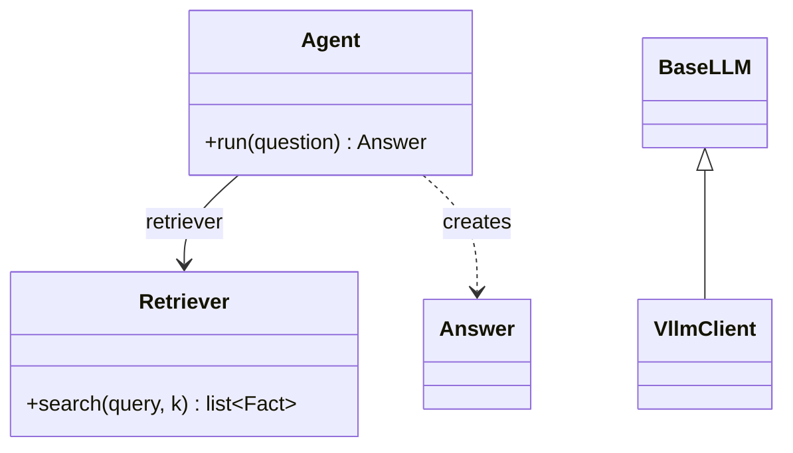
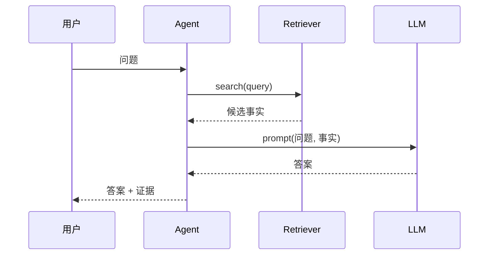

# What each view contains

The 4+1 model (Kruchten) describes one system from several viewpoints. The scenarios tie the
other four together. Each view answers different questions, so do not repeat content across
pages; link instead.

| Page | Answers | Main diagram | Must not contain |
|---|---|---|---|
| `README.md` (overview) | What is this, who uses it, what does it talk to, where do I start? | context flowchart: the system as one box, users and external systems around it | internal classes |
| `logical.md` | What are the core concepts and how do they relate? | `classDiagram` of ≤ 15 core classes (domain objects, main services), with key attributes and methods only; with two or more independent subsystems, one diagram per subsystem of ≤ 12 classes each | helpers, private methods, every class in the repo |
| `development.md` | How is the code organised; what may depend on what; where do I add things? | package/module dependency `flowchart` grouped in `subgraph` layers | runtime details |
| `process.md` | What runs at runtime: processes, services, workers, batch jobs, resident model servers; how do they communicate; what is concurrent; which ports are shared? | `flowchart` of processes and channels (HTTP, queue, files, GPU, subprocess), or `stateDiagram-v2` for a lifecycle | class internals |
| `physical.md` | Where does it run: machines, GPUs, containers, ports, storage, external services, config/secrets? | deployment `flowchart` with nodes as hosts or containers | code structure |
| `scenarios.md` (+1) | How do the pieces cooperate in the 2–4 most important use cases? | one `sequenceDiagram` per scenario, ≤ 8 participants, using the same names as the other views | every edge case |
| `data.md` (optional) | Which datasets, models, indexes and artefacts exist; who produces and consumes them; formats and locations? | data-flow `flowchart` or `erDiagram` | — |
| `decisions.md` | Why is it built this way? | ADR-lite table | tutorials |

## Writing rules

- Start each page with 1–2 sentences on what it shows. No introductions about the 4+1 model
  itself.
- Prefer one table to a paragraph: `| Module | Responsibility | Key symbols |`.
- Link names to source files without line numbers, which go stale:
  `[OrderService](../../shop/services/order.py)`. The agent-facing files may use
  `path:line`.
- Use the same name for the same thing in every view and diagram, matching the code name.
- Mark anything inferred rather than seen in code as "(推断)" / "(inferred)". If it cannot be
  determined, say so instead of guessing.
- Keep diagrams readable: ≤ 20 nodes, short labels, top-down by default. Use `flowchart LR`
  only for a chain of ≤ 6 steps; for longer pipelines stack one `subgraph` per stage top-down,
  use `direction LR` inside each, and connect subgraph to subgraph. Use `subgraph` for layers
  and packages. Put class attributes only where they explain a relationship.
- Mark what you mean with classes, not position-dependent styling:
  `classDef del stroke:#d33,stroke-dasharray:4` then `class old_pkg del`.

## Renderer notes (clean_arch_render)

- Declare a node inside its `subgraph` the first time it appears. A node defined earlier and
  only referenced inside a subgraph stays outside it, and the subgraph renders empty.
- Use ` ` for line breaks in labels. Quote labels that contain parentheses or
  punctuation: `a["load(cfg)"]`.
- Not supported, though they render without error: `o--`/`*--` in class diagrams (the diamond
  is hidden; use a labelled `-->`), `autonumber` and `rect rgb(...)` in sequence diagrams,
  invisible links `~~~`, `linkStyle`, two-way arrows `<-->` (drawn with one head; use two
  edges), dotted links with inline text `-.text.->` (dropped; write `-.->|text|`), and
  non-ASCII subgraph ids (`subgraph 现状` breaks the layout; write `subgraph now["现状"]`). A subgraph's `direction` is ignored when the subgraph
  has no internal edges, and the outer direction is lost when edges cross subgraphs at node
  level; connect subgraph to subgraph instead.
- If a file fails to render, simplify the syntax (plain `flowchart`, no `click`) rather than
  dropping the diagram.

## Diagram snippets

## Common extra views (add only when they matter)

- **State view** (`stateDiagram-v2`) for objects with a real lifecycle (job status, agent loop
  states).
- **Configuration view**: a table of config files and keys, which component reads them, and
  their defaults. Put it in `physical.md` unless it is large.
- **Quality attributes**: 3–5 measurable constraints (latency, GPU memory, throughput, offline
  operation). Put them in `README.md`.
